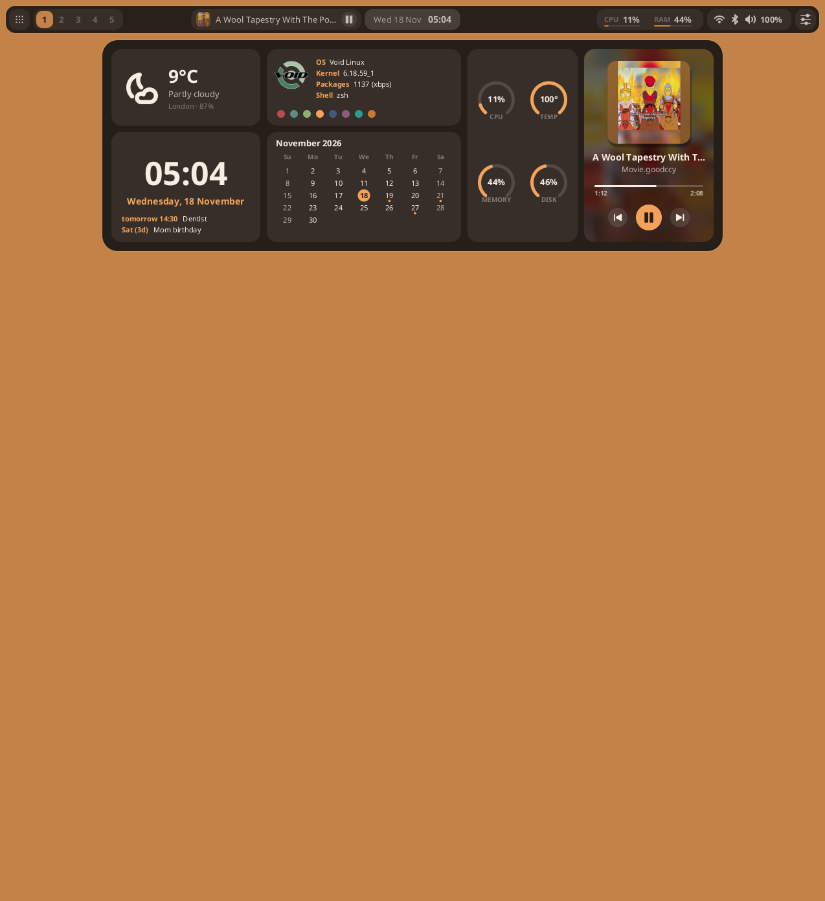
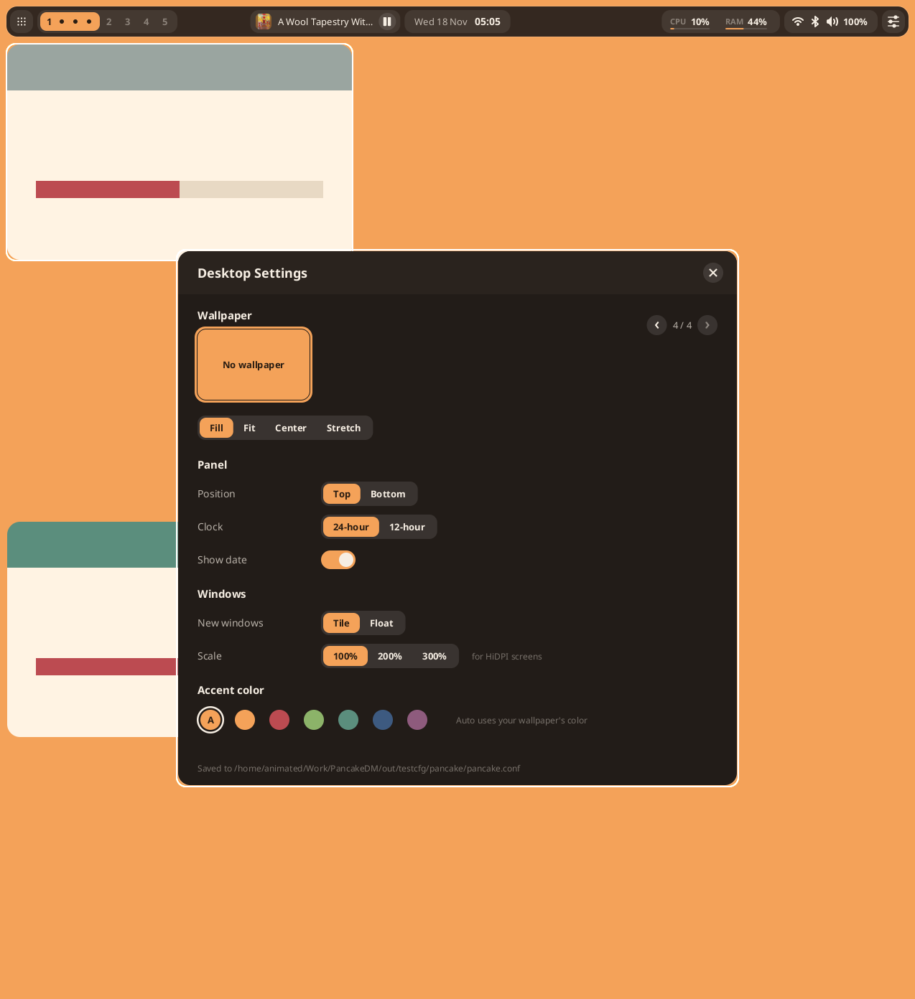
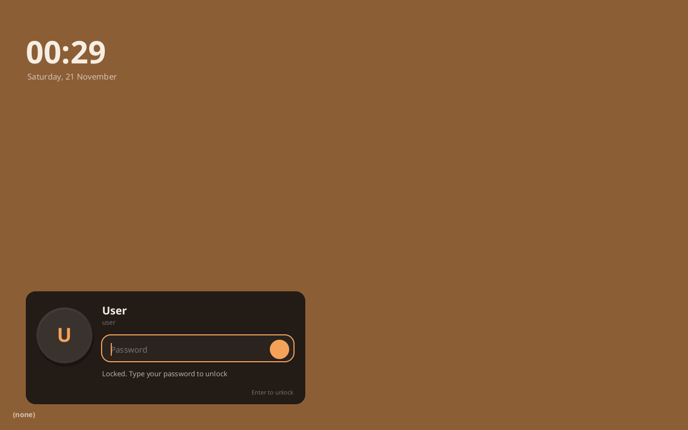
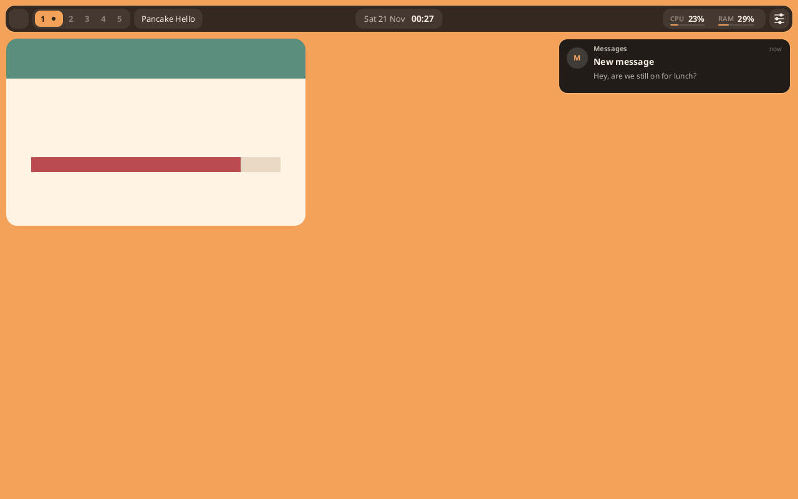
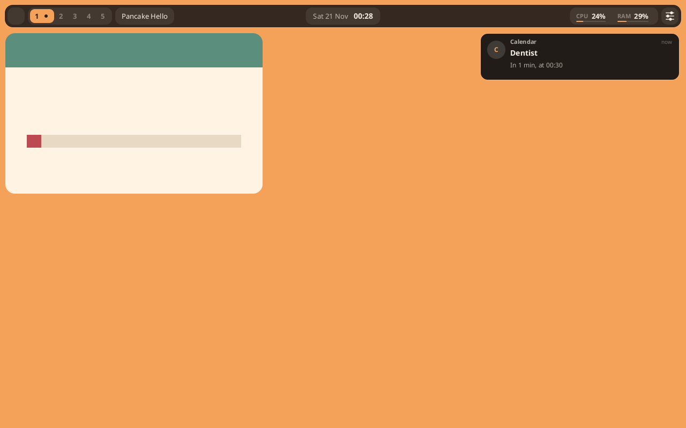

# PancakeDM


A desktop environment for Linux, written from scratch (Rust, with a little
Zig for the low-level parts). It isn't based on GNOME, KDE or Budgie. The
look is warm glass and rounded islands; the goals are the ones KDE gets
right: **configuration, customizability and usability**.

The name is a joke on [Sugar](https://sugarlabs.org/) (Sugar on a Stick),
the desktop made to help children learn to use computers. Sugar goes on
pancakes.



| | |
|---|---|
|  |  |
|  |  |



## Linux distributions

PancakeDM is **Linux only** (it uses DRM/KMS, libinput, libseat, `/proc`,
`/sys` and Linux VTs), but it isn't tied to a distro or init system. Any
distro with the libraries listed under [Try it](#try-it) can run it;
systemd, runit, OpenRC, s6 and others are all fine.

The build and tools cover these package-manager families, from KISS Linux
to Linux Mint:

| Package manager | Examples |
|---|---|
| pacman | Arch, Manjaro |
| dpkg | Debian, Ubuntu, Linux Mint |
| rpm | Fedora, RHEL, openSUSE |
| apk | Alpine |
| xbps | Void |
| kiss | KISS Linux |

Flatpak apps work alongside any of them. On systems without systemd, use
elogind or seatd for seats; where libudev is missing (e.g. KISS), eudev or
libudev-zero provides it. Nested mode only needs a Wayland session; real
screens need DRM/KMS. Only one x86-64 machine has been tested, so treat the
table as expected support, not a tested matrix.

## What's in it

- **Compositor**: a Wayland compositor with dwindle tiling, workspaces 1-9,
  floating windows, rounded corners and borders, animations (windows fade
  and slide, tiles glide, workspaces slide), 1x/2x/3x scaling, and
  keybinds you can change.
- **Panel**: floating "island" bar with workspaces and app icons, the
  focused window, now-playing media, clock, CPU/RAM, status icons
  (network, Bluetooth, volume, battery) and a control center.
- **Dashboard** (click the clock): weather, big clock, calendar with your
  events, system info with your distro's logo, gauges and a media player.
- **Launcher**: full-screen app search with real icons (tap Super).
- **Low-power mode**: backs off by itself when the CPU is hot.
- **Desktop Settings**: wallpaper, panel, tiling, scale and accent color;
  changes apply live. The accent can follow your wallpaper.
- **Login screen**: a greetd greeter, in the same style.
- **Lock screen and notifications**: Ctrl+Alt+L locks the session; app
  notifications and calendar reminders appear as native, dismissible toasts.
- **Tools**: `pancake-fetch` (a fastfetch-like summary) and `pancake-event`
  (calendar events).

It works with any init system (systemd, runit, OpenRC...) and never asks
you to change yours. Seats come from libseat (logind, elogind or seatd).

> **Status: first release, early.** It runs real GTK apps and has only been
> tested on one machine. Expect rough edges. Only software rendering for
> now, so it uses more CPU than it will once there's GPU rendering.

## Try it

Build (needs Rust and make; Zig 0.13+ is optional but needed for running on
real screens; libdrm, libinput, libudev, libseat, libxkbcommon):

```sh
make              # uses 2 jobs by default; make JOBS=1 on a hot PC
```

**Inside another Wayland desktop** (safest; PancakeDM opens as a window):

```sh
./target/release/pancake-compositor
WAYLAND_DISPLAY=wayland-2 your-app       # the display name it prints
```

**On real screens** (from a text console, Ctrl+Alt+F3):

```sh
dbus-run-session ./target/release/pancake-compositor --drm
```

Ctrl+Alt+Backspace quits. Install with `make PREFIX=/usr install`.

## Keys

| Keys | Action |
|---|---|
| Super+Return | terminal |
| Super+Space, or tap Super | launcher |
| Super+Q | close window |
| Super+arrows or H J K L | focus; with Shift: swap |
| Super+1..9 | workspace; with Shift: move window there |
| Super+V / Super+F | float / maximize |
| Alt+drag | move a window |

Change or add binds in `[keybinds]` in `~/.config/pancake/pancake.conf`
(for example `super+t = spawn foot`).

## Calendar

```sh
pancake-event add tomorrow 14:30 Dentist
pancake-event add 2026-12-25 Christmas
pancake-event list
```

Events show up on the dashboard (a dot under each day, and what's next).
Click the **+** in the dashboard calendar for guided date, time and title
entry, or run `pancake-event add` with no other arguments. Timed events notify
you ten minutes before they start; all-day events remind you in the morning.
They're a plain text file at `~/.local/share/pancake/events`.

## Media controls

The panel discovers MPRIS players individually and prefers the active player
(including Spotify) over stale browser sessions. Install `playerctl` to enable
now-playing metadata and playback controls.

## Privacy

The dashboard's weather comes from wttr.in, which sees your IP address.
Set `weather-location` to a city or `weather = off` in `[panel]` to change
that. Nothing else leaves your machine.

## More

[docs/architecture.md](docs/architecture.md) covers the design, the config
file, the login screen setup and testing in QEMU.

Licensed GPL-3.0-or-later.
